<p align="center">
  
</p>

<p align="center">
  Orbital Telemetry design system · Three.js Earth · 7 WebGL2 shaders · 26 synced GitHub repositories
</p>

<p align="center">
  <a href="https://work.jorgebucio.com/">
    
  </a>
  <a href="https://github.com/ZynzTehr">
    
  </a>
</p>

---

## System overview

ZynzTehr Portfolio is a static single-page React 19 and TypeScript application built with Vite+ (`vp`) and Tailwind CSS v4. It synchronizes all non-fork public repositories from the `ZynzTehr` GitHub account at build time, pairs every project with both bespoke vector artwork (`ProjectArt`) and real `1440x900` `portfolio.webp` application snapshots (plus silent looping `portfolio.mp4` previews for motion-heavy builds), and presents them across a 3D Three.js orbital carousel and a shader-backed repository archive.

Clicking any project card expands its media inline to the left via GSAP FLIP geometry rather than opening a modal overlay. Concave surface-matched notches along the top-left, bottom-left, and right edges of the media frame display the project name, tech stack, and repository topics over live video or snapshot imagery, while the right column renders structured category, language, and date tags above the project description and deployment links.

### Design tokens and typography

| Token | Value | Role |
| --- | --- | --- |
| `--bg-void` | `#03060f` | Root document canvas |
| `--bg-base` | `#060b19` | Primary page surface |
| `--surface-1` | `#0a1124` | HUD, card chassis, and control pills |
| `--surface-2` | `#0e1730` | Active split-stage surface and concave media notches |
| `--accent-core` | `#0d59ff` | Deep cobalt laser horizon core |
| `--accent-primary` | `#4474ff` | Primary electric sapphire accent and fluid cursor tint |
| `--accent-bright` | `#60a5fa` | Ice-blue focus rings, badges, and ASCII shader highlights |
| `Space Grotesk` | Display font | Hero statements, HUD identity, card titles, and notched titles |
| `Plus Jakarta Sans` | Body font | Descriptions, navigation labels, and action buttons |
| `JetBrains Mono` | Telemetry font | Tech stack chips, topic tags, repository counters, and dates |

---

## Subdirectories and system boundaries

```text
ZynzTehr-Portfolio/
├── .github/workflows/deploy.yml          # GitHub Pages CI workflow
├── vercel.json                           # Vercel static build and routing config
├── client/
│   ├── index.html                        # Entry HTML and Google Fonts preconnects
│   ├── vite.config.ts                    # Vite+ (Oxfmt, Oxlint, Rolldown) + Tailwind v4 config
│   ├── scripts/
│   │   ├── sync-repos.js                 # GitHub REST API repository sync -> src/data/projects.json
│   │   └── generate-art.js               # Idempotent SVG component generator for new repos
│   └── src/
│       ├── components/
│       │   ├── CardMediaPreview.tsx      # Resting SVG -> hover WebP/MP4 + DecryptReveal
│       │   ├── DevHud.tsx                # Top telemetry bar with HexAvatar and PageLoadSweep
│       │   ├── Earth3D.tsx               # Three.js globe with Fresnel atmosphere and night lights
│       │   ├── Layout.tsx                # App shell and viewport-bounded Liquid fluid layer
│       │   ├── ProjectCarousel.tsx       # 3D perspective orbit showcase and category tabs
│       │   ├── ProjectStage.tsx          # Inline split-stage showcase with multi-side notches
│       │   ├── ScrollWidget.tsx          # Scroll progress and archive reset control
│       │   ├── canvasui/                 # 7 standalone WebGL2 shaders + DOM snapshot engine
│       │   └── project-arts/             # 18 hand-crafted + 8 generated SVG components
│       ├── data/
│       │   ├── projects.json             # Build-time synced repository manifest (26 repos)
│       │   └── projects.ts               # Typed schema, category classifier, and date formatter
│       ├── pages/
│       │   ├── Landing.tsx               # GlyphRain intro with GSAP kinetic typography
│       │   └── Home.tsx                  # Carousel, ParticleScroll archive, and Laser horizon
│       └── styles/
│           ├── index.css                 # Tailwind CSS v4 import and @theme tokens
│           └── global.css                # Orbital Telemetry components, 3D orbit, and notches
└── README.md
```

---

## Interface

### Routes

Uses `HashRouter` for static-host portability across Vercel and GitHub Pages:

- `/#/` renders `Landing` (`GlyphRain` backdrop, `PageLoadSweep` badge, kinetic intro phrases, and `Skip Intro` shortcut).
- `/#/home` renders `Home` (`DevHud`, `ProjectCarousel` or inline `ProjectStage`, click-to-unlock `ParticleScroll` archive grid, and viewport-bottom `Laser` horizon).

### Scripts (`client/package.json`)

| Command | Behavior |
| --- | --- |
| `npm --prefix client run dev` | Starts local Vite+ development server on `http://localhost:5173` |
| `npm --prefix client run sync` | Fetches `ZynzTehr` repos, regenerates missing SVG art, and formats `projects.json` |
| `npm --prefix client run check` | Runs `vp check` (Oxfmt formatting + Oxlint + TypeScript validation) |
| `npm --prefix client run build` | Runs `sync`, `tsc -b`, and `vp build` into `client/dist/` |
| `npm --prefix client run preview` | Serves the production bundle locally on `http://127.0.0.1:4173` |

---

## Invariants

1. **Non-destructive SVG generation.** `client/scripts/generate-art.js` parses `ProjectArt.tsx` and never overwrites the 18 hand-crafted SVG artworks; it generates components under `src/components/project-arts/generated/` only for newly discovered repositories.
2. **WebGL context ceiling.** Simultaneous connected WebGL/WebGL2 contexts remain at or below `6` across every route and interaction (`Liquid`, `Earth3D`, `ParticleScroll`, `Laser`, and either active hover `DecryptReveal` or `ProjectStage`'s `GlyphRain` + `Asciify`, while `PageLoadSweep` unmounts its WebGL2 context immediately on `onSweepEnd`).
3. **CORS-clean media textures.** Every external repository `portfolio.webp` and `portfolio.mp4` asset loads from `raw.githubusercontent.com` (`Access-Control-Allow-Origin: *`) with `crossOrigin="anonymous"` so `DecryptReveal` and `Asciify` upload frames to WebGL2 textures without tainting 2D snapshot canvases.
4. **Motion and pointer adaptation.** Every animation and shader honors `prefers-reduced-motion: reduce`, and fine-pointer shaders (`Liquid`, `DecryptReveal`, and cursor lens tracking) stand down automatically on coarse touch viewports.
5. **Disjoint notch geometry.** On both desktop (`16:10`) and mobile (`4:3`) frames, `.notch-top-left`, `.notch-bottom-left`, and `.notch-right-side` occupy non-overlapping regions while matching `--surface-2` (`#0e1730`) identically to prevent sub-pixel seams.

---

## Side effects

- **Network reads at sync time.** `client/scripts/sync-repos.js` queries `https://api.github.com/users/ZynzTehr/repos?sort=updated&per_page=100` (optionally authenticated via `GITHUB_TOKEN` to avoid unauthenticated rate limits). If the GitHub API is unreachable or rate-limited (`403`), `sync-repos.js` logs a warning and preserves the checked-in `client/src/data/projects.json` so builds still succeed offline.
- **Filesystem writes at sync time.** `npm --prefix client run sync` overwrites `client/src/data/projects.json` and writes any newly generated `.tsx` files under `client/src/components/project-arts/generated/`.
- **Runtime media fetches.** Hovering a card or opening `ProjectStage` fetches `portfolio.webp` (and `portfolio.mp4` for the 6 motion-enabled repositories) from `https://raw.githubusercontent.com/ZynzTehr/<repo>/main/`.

---

## Verification

Run the full local verification suite from the repository root:

```bash
# 1. Format check, lint, and typecheck
cd client && npx tsc -b && npm run check

# 2. Sync repositories, build production bundle, and audit dependencies
cd .. && npm --prefix client run build && npm --prefix client audit
```

Expected output:

- `vp check` reports `0` formatting issues, `0` warnings, and `0` lint or type errors.
- `npm --prefix client run build` exits `0` and emits `client/dist/`.
- `npm --prefix client audit` reports `found 0 vulnerabilities`.
